<p align="center">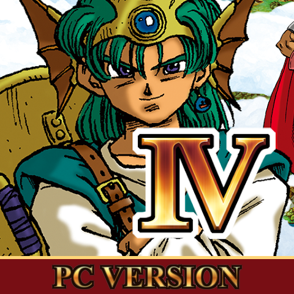</p>

# Dragon Quest IV: native PC version

The original Nintendo DS game (built from its decompilation) runs natively on Windows, without an emulator. It has HD rendering, both screens joined into one 16:9 picture, the mobile version's sound and the party chat back in every language.

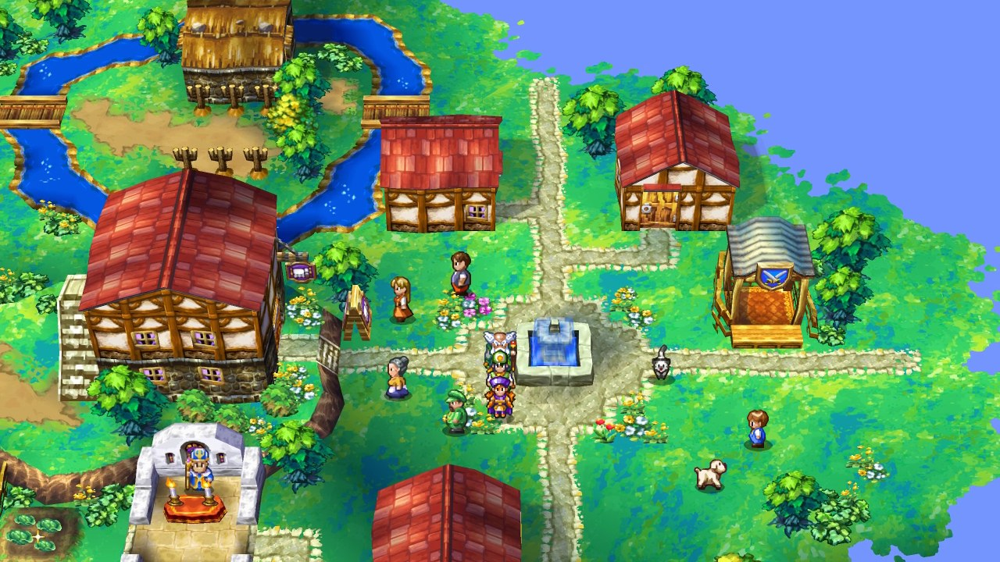

## Playing

Double-click `dist\DragonQuestIV.exe`. Every game resource is packed inside it, so it can be moved on its own.

The game keeps its files in a `saves` folder next to the executable:

| File | Contents |
| --- | --- |
| `dqiv_eur.sav` | the game save |
| `settings.ini` | the PC settings |
| `journal.txt` | the log (details of an error, if the game stops) |

Moving the game together with its `saves` folder keeps your progress. On the first start, a save from an earlier version (`%LOCALAPPDATA%\DQIV-PC`) is copied into `saves` automatically.

### Default controls

All keys and gamepad buttons can be changed in the settings.

| Action | Keyboard | Gamepad |
| --- | --- | --- |
| Move / choose | Arrow keys | D-pad or left stick |
| A (confirm) | Z or Space | A |
| B (cancel) | X, Backspace or Escape | B |
| X / Y | S / A | Y / X |
| L / R | Q / W | LB / RB |
| Start / Select | Enter / Right Shift | Start / Back |
| Party chat (when walking, outside menus) | E | B |
| Camera zoom | Mouse wheel, numpad + / - | Right stick |
| DS touch screen | Left click on the bottom view | |

Letters follow the active keyboard layout (AZERTY included).

Function keys:
- **F8**: 16:9 picture or the DS screens' width.
- **F9**: window size.
- **F10**: stretch or keep proportions.
- **F11**: fullscreen.
- **F12**: PNG screenshot, saved in `%APPDATA%\DQIV-PC`.

## What's new

### Both screens become one picture

On the DS, towns and dungeons are drawn on two screens, each at 30 frames per second (the bottom screen on odd frames, the top one on even frames). Here every frame is drawn whole by the bottom camera, extended over the top screen: one seamless picture at 60 frames per second. In 16:9 the scene widens at the sides.

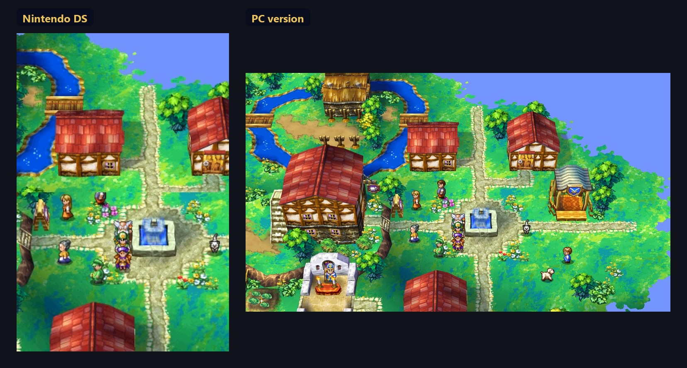

### HD rendering

The 3D is drawn by the graphics card at the window's resolution:
- 2x supersampling, which lowers itself automatically if the card can't hold 60 fps;
- textures upscaled (Scale2x) and filtered;
- backgrounds, sprites and text keep sharp pixels at any size.

Menu icons and the party's portraits are drawn in high resolution. Above 60 fps (120, 144, 165, 240 Hz or unlimited), the 3D is redrawn between the game's frames for smoother movement.

The world map fills the whole picture and scrolls at 60 frames per second. The top screen's map becomes an inset.

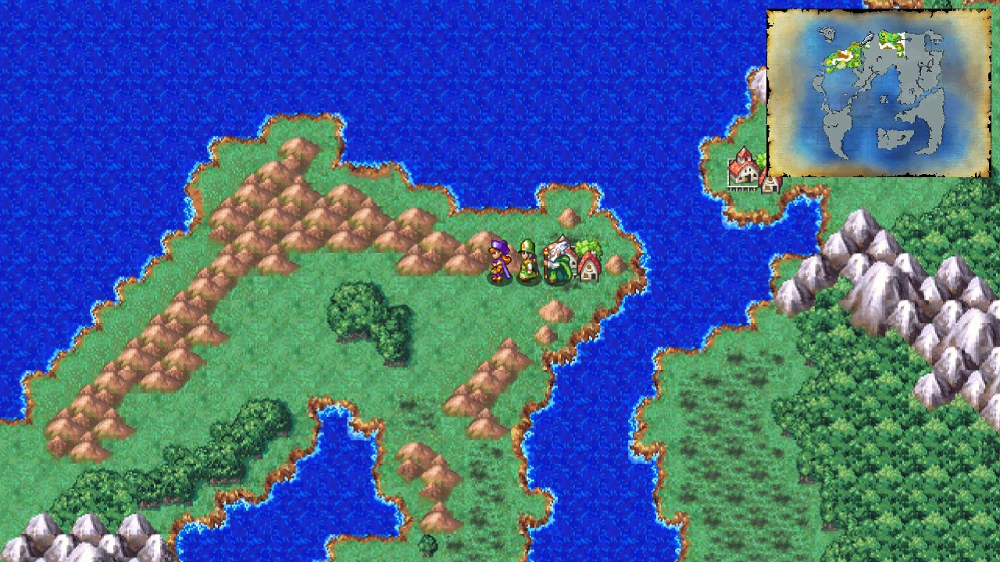

The opening's cloud sky is widened to fill 16:9.

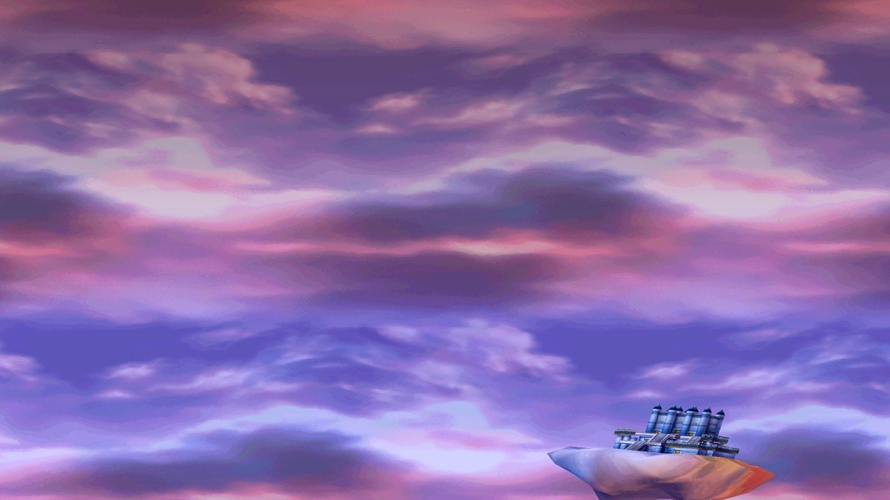

### Camera zoom

The camera zooms from 50% to 200% in towns, dungeons and on the world map. Use the mouse wheel, numpad + / -, the right stick, or Settings > Display.

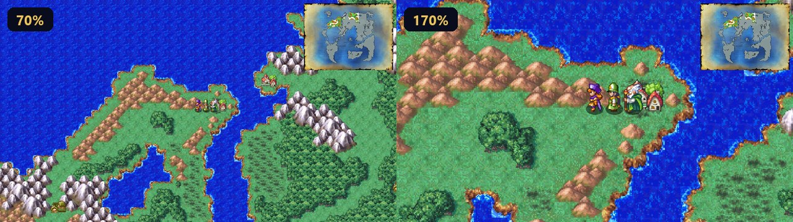

### 16:9 battles

The battle scene covers the whole picture: the sky continues above, the sides are wider, and the top screen's status windows stay on top. Names, cursor and target circle stay on the monsters, as on the DS.

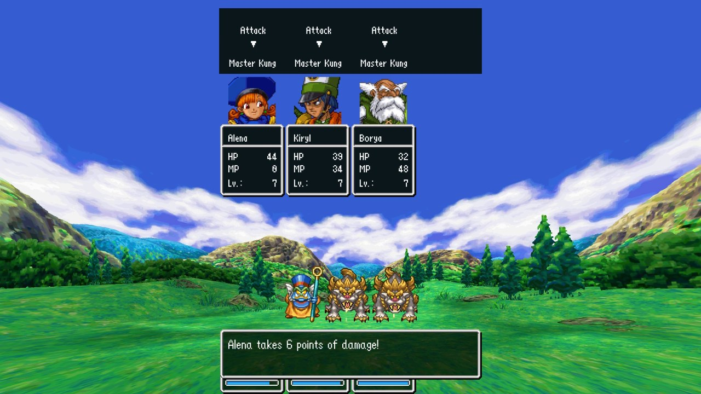

### Monster names colored by HP

As in the HD-2D remakes, a monster group's name turns yellow when one of them is at 25% of its HP or less, and red under 10%.

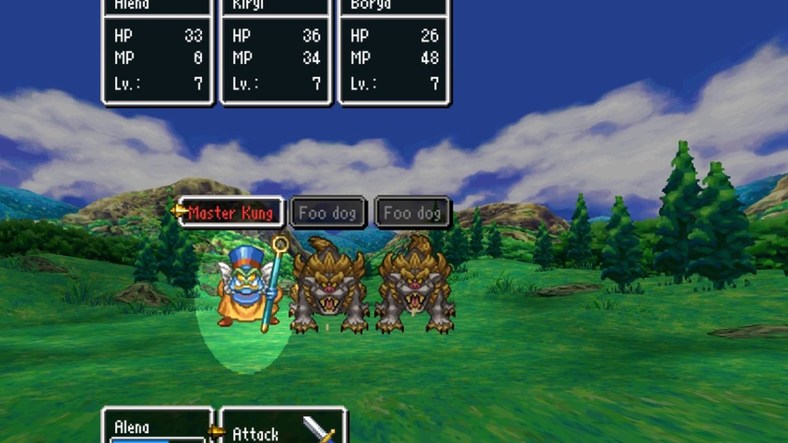

### Party chat is back

The Japanese and mobile versions let you talk to your party; the European DS version had removed it. Press **E** (or **B** on a gamepad) while walking, or use "Talk" with nobody in front of you, and a party member says something. Lines depend on the place, the story so far, the time of day and who is in the party.

The English text comes from the mobile version, with the fixes of the dq4-partychat-patcher.

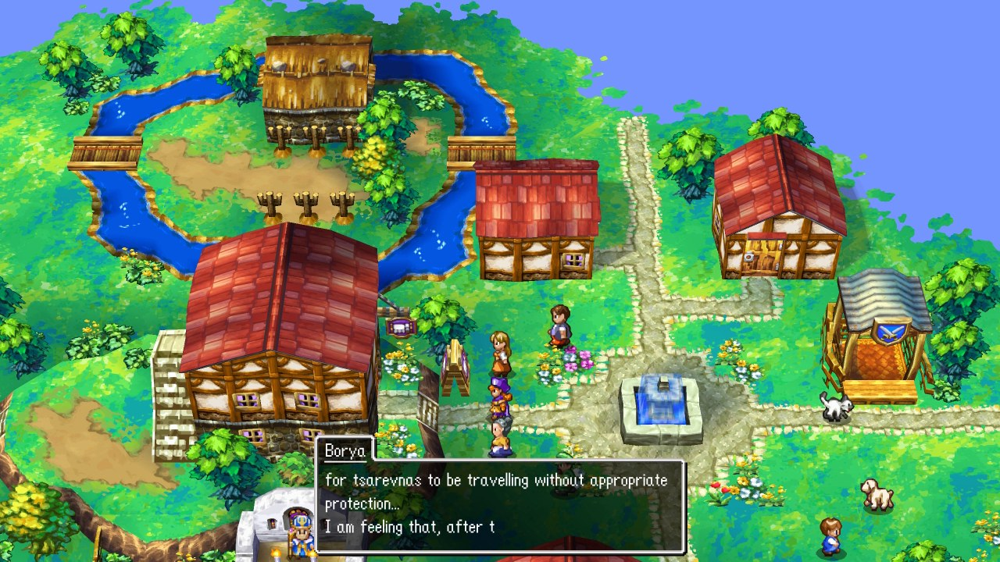

All 7,796 lines were translated into French, German, Italian and Spanish, in the style of the official DS translations: official names, and characters keep their accents (Alena, Kiryl and Borya keep their Zamoksvan accent). Japanese uses the original text of the Japanese DS version. The files are in `addons/data/MESS/<language>/b05xxxxx.mpt`.

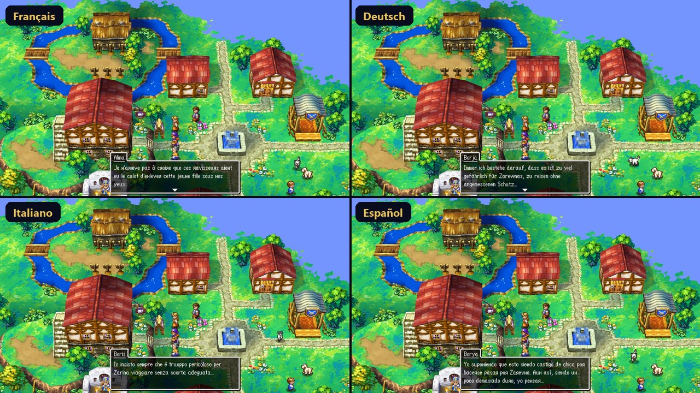

### Japanese

The game can be played in Japanese: texts, menus and party chat, taken from the original Japanese version, whose texts are already in the European game data. Choose "Japanese" (日本語) in Settings > Game > Language. The language changes at once, even in the middle of a game. In Japanese, the party windows have no portrait, so the names use the full width.

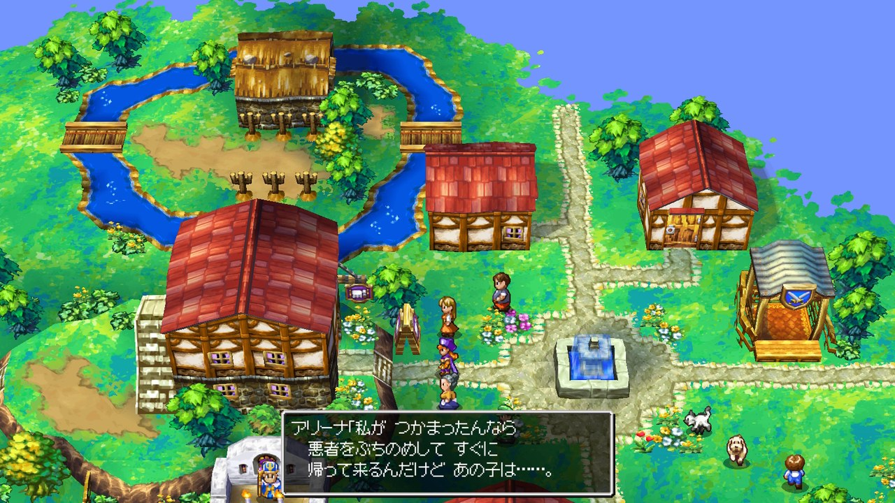

### HD sound from the mobile version

Settings > Game > HD sound:
- **Mobile** (the default) plays the smartphone version's recordings instead of the DS synthesizer: music in Ogg Vorbis 44.1 kHz stereo, sound effects in ADPCM. Loops, volumes and fades stay the same.
- **DS** brings back the original sound.

They come from the Android version's data file (`.obb`), extracted when the game is built (see [Building](#building)).

### PC settings

The same screen, in the game's style, opens from "Settings" in the adventure log menu and, during a game, from **Misc > Settings** (it replaces the DS's three sliders). L / R switch between the four pages. Left / right change the selected line.

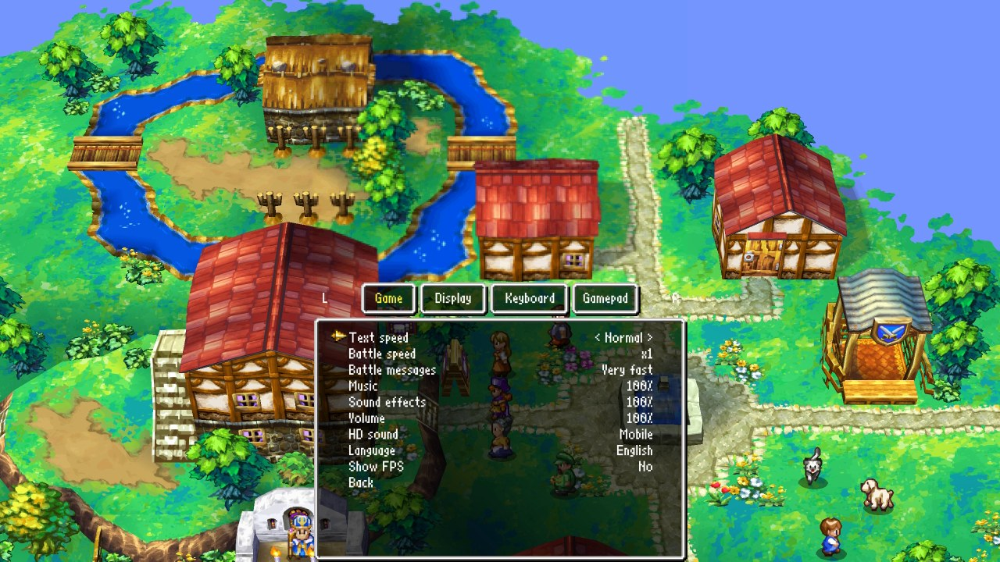

- **Game**:
  - text speed: Slow, Normal, Fast, Instant;
  - battle speed, x1 to x4: the whole battle runs faster, the music keeps its tempo;
  - battle messages, music and sound effects (during a game);
  - volume, HD sound, language;
  - FPS display.
- **Display**:
  - fullscreen and window size;
  - frames per second: 60, 120, 144, 165, 240 or unlimited;
  - camera zoom;
  - 16:9 or DS screens, stretching;
  - vertical sync, 3D quality, smooth textures.
- **Keyboard** and **Gamepad**: the key or button for each action (A, B, X, Y, L, R, Start, Select, directions, party chat). Press A on a line, then the new key; Escape cancels. "Default controls" restores the page.

On laptops with two graphics chips, the game asks for the dedicated one (NVIDIA / AMD).

### More

- **Quick save anywhere**: Misc > Quick save works everywhere, dungeons included, except in the middle of an action (rope, fall, stairs). The game then goes on; on the DS it stopped. Resuming the interrupted adventure from the adventure log menu brings you back to the exact same spot.
- **Shops**: the buy list has tabs at the top: every item first, then the categories the shop sells (weapons, armour, shields, helmets, accessories, items); L / R switch tabs. Every item has its HD icon next to its name.
- **Menus over the world**: the scenery stays on the whole 16:9 picture, frozen as on the DS, and the windows float over it. There are no black bars or stacked DS screens.
- **Two-screen scenes** (logos, casino, monster book, adventure log menus): both screens are placed side by side and enlarged. When one screen stays empty, the other is shown alone at twice the size.
- **Transitions**: the shattering effect when a battle starts covers the whole 16:9 picture. The ending's staff roll scrolls from one screen to the other without a break.
- **Wireless**: the DS radio is emulated with no other console in range (tag mode, exchanges). The game behaves like a single DS and stays fully playable.
- **Crash fixes**: a division by zero that crashed the original code after the Master Kung battle (chapter 2) now behaves as on the DS. Any other error shows a message, with its details in `saves\journal.txt`.

## Building

The project contains no game data: it comes from your own copies of the game. Put them in the `ROMandOBBfileHere` folder:

| File | |
| --- | --- |
| Your **European Dragon Quest IV ROM** for Nintendo DS (game code `YIVP`): the `.nds` file, or a `.zip` that contains it | required |
| The **Android version's data file** (`main.xxxxx.com.square_enix.android_googleplay.dq4.obb`) | optional: HD music and sound effects; without it, the game uses the DS sound |

You also need:
- CMake 3.24 or later;
- Visual Studio 2022 (C++) and the Windows SDK;
- Internet access on the first build: SDL3 and stb_vorbis are downloaded and checked.

Then run:

```bash
powershell -ExecutionPolicy Bypass -File .\build.ps1
```

The script:
1. compiles the game;
2. if the `assets` folder is missing the game's data, extracts it from the ROM (the ROM's own file system, unchanged);
3. if it is missing the HD sound and an `.obb` is there, extracts its sounds;
4. packs everything into `dist\DragonQuestIV.exe`.

The extraction is done only once: later builds reuse `assets`. To redo it, delete `assets`.

The build is 32-bit (Win32), because the original game resources contain 32-bit pointers; it runs on 64-bit Windows. Intermediate files go to `build32`, which can be deleted afterwards: only `dist\DragonQuestIV.exe` matters.

### Project contents

| Folder / file | Contents |
| --- | --- |
| `game\` | the game's sources (decompilation) and the parts of the DS SDKs it uses |
| `native\` | the PC layer: window, OpenGL rendering, sound, files, settings |
| `addons\` | the PC version's additions: the party chat texts (English, French, German, Italian, Spanish) |
| `ROMandOBBfileHere\` | where you put your ROM and `.obb` (never added to git) |
| `assets\` | created by `build.ps1`: the game's data extracted from your ROM and `.obb` (never added to git) |
| `icon\` | the game's icon (`DragonQuestIV.ico`, built into the executable) |
| `docs\images\` | the pictures of this page |
| `cmake\` | placement of the game's modules (DS overlays) |
| `build.ps1` | builds the game and creates `dist\DragonQuestIV.exe` |
